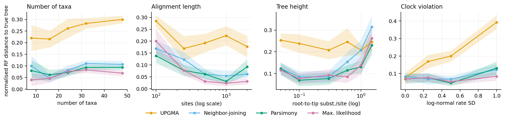
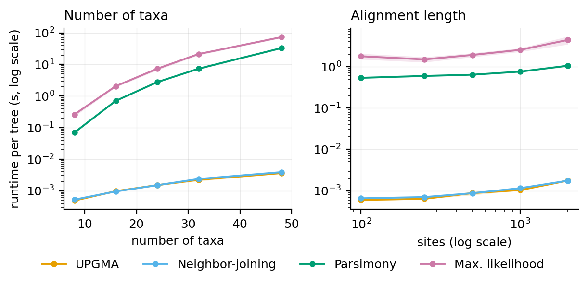
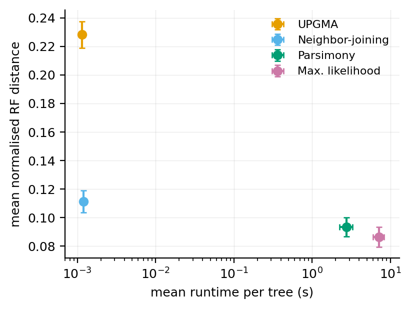
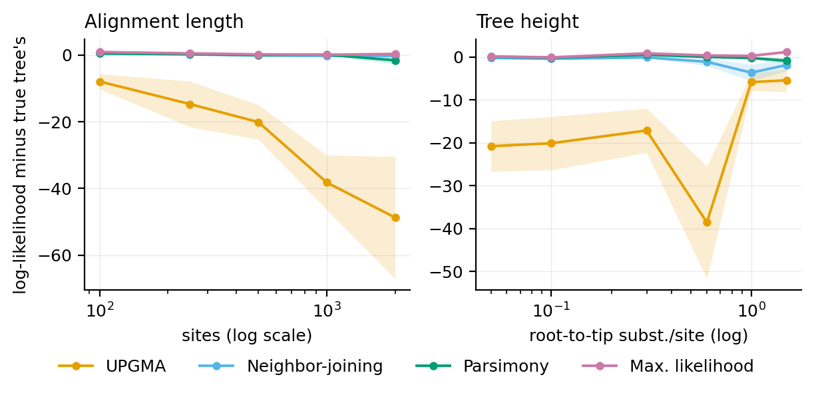
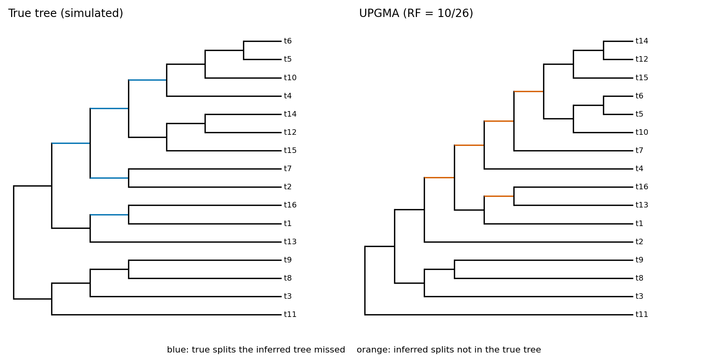
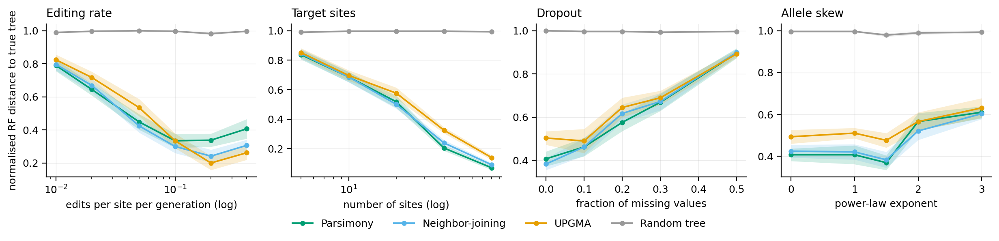
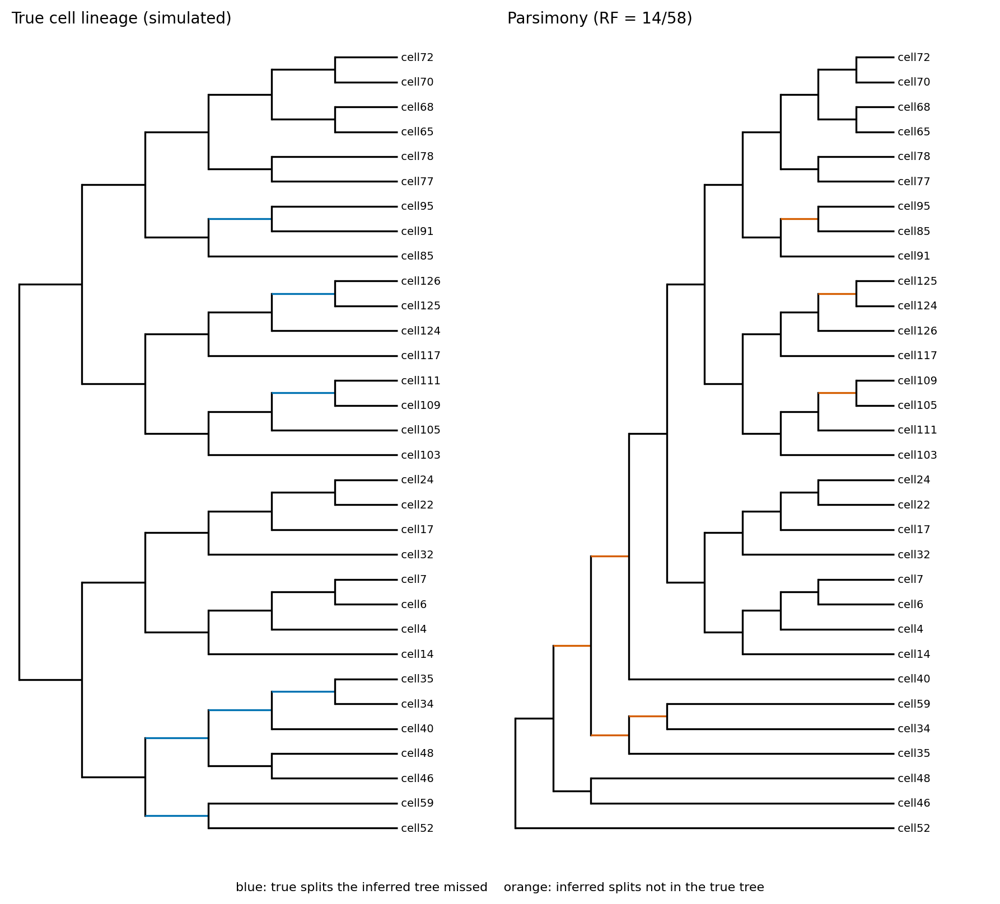

# Phylogenetics from scratch

UPGMA, neighbor-joining, maximum parsimony and maximum likelihood, written
from the ground up in Python. The package also includes a benchmark on
simulated data with known true trees, and a small experimental module for
CRISPR lineage-tracing data.

I wrote this to understand these algorithms properly rather than calling a
library. The core logic (tree handling, Newick, distances, all four
inference methods, tree search, simulation and evaluation) is in this
repository. NumPy and SciPy are only used for arrays and for one 1-D
optimiser (Brent's method).

The project started from the Bioinformatics Algorithms course at the
University of Basel (HS 2023)

---

## Contents

- [Scientific motivation](#scientific-motivation)
- [Installation](#installation)
- [Quick start](#quick-start)
- [What is implemented](#what-is-implemented)
- [Results](#results)
- [CRISPR lineage-tracing extension](#crispr-lineage-tracing-extension)
- [Correctness checks](#correctness-checks)
- [Reproducing everything](#reproducing-everything)
- [Limitations](#limitations)
- [Future directions](#future-directions)
- [Repository layout](#repository-layout)

---

## Scientific motivation

Tree reconstruction methods make different trade-offs:

- **Distance methods** (UPGMA, NJ) squash the alignment into one number per
  pair of sequences. That is fast, but information is lost.
- **Parsimony** looks for the tree that needs the fewest mutations, which
  can be misleading when many changes happen on the same site.
- **Likelihood** uses an explicit model of evolution. It is the most
  principled of the four, and the slowest.

Which one works best depends on the data: how many taxa, how long the
alignment, how divergent the sequences are, and whether rates are similar
across lineages.

With real data the true tree is unknown, so the only way to measure
accuracy is simulation. This project simulates alignments on known trees,
varies one factor at a time, and measures how far each method's tree is
from the truth.

The same question comes up in **CRISPR lineage tracing**, where the "taxa"
are cells and the characters are Cas9-induced edits. The lineage module
applies the general algorithms to a simplified simulation of that data, to
see where they work and where the assumptions break.

## Installation

Python 3.9 or newer.

```bash
git clone https://github.com/<your-username>/phylogenetics-from-scratch.git
cd phylogenetics-from-scratch
python -m venv .venv
source .venv/bin/activate          # Windows: .venv\Scripts\activate
pip install --upgrade pip          # older pip (e.g. 21.x) cannot do editable installs from pyproject.toml
pip install -e ".[dev]"            # numpy, scipy, matplotlib, pytest
python -m pytest                   # 99 tests, under a minute
```

The only runtime dependencies are NumPy, SciPy and matplotlib.

## Quick start

From the command line (`phylo` is installed with the package; `python -m phylo` also works):

```bash
# a hand-made 4-taxon example: the best tree needs 4 changes
phylo infer data/examples/hand_example.fasta --method parsimony

# simulate data with a known tree, infer it with ML, and compare
mkdir -p out
phylo simulate --taxa 12 --sites 800 --height 0.3 --seed 7 \
    --out-fasta out/sim.fasta --out-tree out/true.nwk
phylo infer out/sim.fasta --method ml --out out/ml.nwk --plot out/ml.png
phylo compare out/true.nwk out/ml.nwk --plot out/compare.png

# other commands
phylo distance data/examples/simulated_12taxa.fasta          # JC69 distance matrix (CSV)
phylo score data/examples/simulated_12taxa_true.nwk data/examples/simulated_12taxa.fasta
```

From Python:

```python
from phylo import Alignment, distance_matrix, robinson_foulds
from phylo.methods import upgma, neighbor_joining, parsimony_search, ml_search, CharacterData
from phylo.newick import read_newick_file

aln = Alignment.from_fasta("data/examples/simulated_12taxa.fasta")
true_tree = read_newick_file("data/examples/simulated_12taxa_true.nwk")

nj_tree = neighbor_joining(distance_matrix(aln))
mp = parsimony_search(CharacterData.from_alignment(aln), n_starts=10, seed=0)
ml = ml_search(aln)

print(nj_tree.to_newick())
print("parsimony score:", mp.score, " log-likelihood:", round(ml.log_likelihood, 2))
print("RF distance (ML vs truth):", robinson_foulds(true_tree, ml.tree).distance)
```

## What is implemented

| Component | Status | Notes |
|---|---|---|
| Tree data structure, splits, NNI moves | complete | `phylo/tree.py` |
| Newick parser and writer | complete | quoted labels, comments, internal labels; round-trip tested |
| FASTA input and alignment checks | complete | equal-length check, IUPAC ambiguity codes, gaps/`N`/`?` treated as missing |
| p-distance and Jukes–Cantor distance | complete | pairwise deletion of missing data; saturated pairs capped and counted |
| UPGMA | complete | O(n³) |
| Neighbor-joining | complete | O(n³); negative branch lengths clamped by default (`allow_negative=True` keeps them) |
| Fitch parsimony scoring | complete | vectorised over site patterns; DNA and up to 64-state characters |
| Parsimony tree search | heuristic | random stepwise addition + NNI + SPR from several starts (plus the NJ tree); exhaustive search for ≤ 8 taxa |
| Felsenstein pruning under JC69 | complete | per-node scaling against underflow |
| ML branch-length optimisation | complete | Brent's method per branch, repeated until converged |
| ML tree search | heuristic | NNI hill climbing from NJ, UPGMA and parsimony starts |
| Robinson–Foulds distance | complete | unrooted, raw and normalised |
| Yule tree + JC69 sequence simulation | complete | optional relaxed clock and missing data |
| Benchmark pipeline, figures | complete | JSON configs, fixed seeds, CSV output |
| CRISPR lineage-tracing simulator + reconstruction | experimental | see [below](#crispr-lineage-tracing-extension) |

Short descriptions of each algorithm are below. The longer version is in
[`docs/algorithms.md`](docs/algorithms.md), and every module starts with a
docstring explaining its method.

- **UPGMA** repeatedly joins the two closest clusters and averages their
  distances to everything else. Its trees are ultrametric, so it only works
  well when rates follow a molecular clock.
- **Neighbor-joining** joins the pair that minimises
  Q(i,j) = (r−2)·d(i,j) − Rᵢ − Rⱼ. That correction lets it recover any tree
  whose distances are additive, with or without a clock.
- **Fitch parsimony** passes once from the leaves to the root, taking the
  intersection of the children's state sets where they overlap and their
  union (one change) where they don't. The search is random stepwise
  addition followed by NNI and then SPR hill climbing, from several random
  orders plus the NJ tree.
- **Maximum likelihood** uses Felsenstein's pruning algorithm under JC69,
  with rescaling to prevent underflow. Branch lengths are optimised one at a
  time using cached "outside" likelihood vectors, so each evaluation costs
  O(sites). The tree search is NNI hill climbing from three starting trees.

## Results

All numbers below come from `results/dna_benchmark/` and
`results/lineage_benchmark/`, which `experiments/check_results.py` checked:

- every dataset completed for every method (200/200 DNA, 210/210 lineage);
- no invalid values;
- the search methods compared on their own criterion (see
  [Verifying the results](#verifying-the-results)).

There are 10 replicates per condition, so differences of a few hundredths
in RF distance between NJ, parsimony and ML are usually within the standard
errors. Read the curves as trends, not rankings.

**Setup.** Yule trees, JC69 sequences. Base condition: 16 taxa, 500 sites,
tree height 0.3 substitutions/site, relaxed clock with log-normal SD 0.5.
One factor is varied at a time (config: `experiments/configs/dna_benchmark.json`).



Mean normalised RF distance to the true tree (± standard error, n = 10).
Lower is better:

| Clock violation (rate SD) | 0.0 | 0.25 | 0.5 | 1.0 |
|---|---|---|---|---|
| UPGMA | 0.077 | 0.169 | 0.200 | 0.392 |
| Neighbor-joining | 0.085 | 0.069 | 0.069 | 0.123 |
| Parsimony | 0.069 | 0.077 | 0.046 | 0.131 |
| Max. likelihood | 0.069 | 0.077 | 0.054 | 0.085 |

| Alignment length (sites) | 100 | 250 | 500 | 1000 | 2000 |
|---|---|---|---|---|---|
| UPGMA | 0.285 | 0.169 | 0.192 | 0.223 | 0.177 |
| Neighbor-joining | 0.169 | 0.123 | 0.062 | 0.054 | 0.062 |
| Parsimony | 0.138 | 0.077 | 0.062 | 0.031 | 0.092 |
| Max. likelihood | 0.200 | 0.077 | 0.031 | 0.023 | 0.031 |

| Tree height (subst./site) | 0.05 | 0.1 | 0.3 | 0.6 | 1.0 | 1.5 |
|---|---|---|---|---|---|---|
| UPGMA | 0.254 | 0.238 | 0.208 | 0.246 | 0.208 | 0.246 |
| Neighbor-joining | 0.123 | 0.085 | 0.085 | 0.154 | 0.208 | 0.315 |
| Parsimony | 0.123 | 0.069 | 0.077 | 0.115 | 0.131 | 0.231 |
| Max. likelihood | 0.115 | 0.077 | 0.092 | 0.085 | 0.138 | 0.262 |

Over all 200 datasets, each method recovered the true topology exactly
(RF = 0) in: UPGMA 17, NJ 54, parsimony 66, ML 67.

What the results show, and how that compares to what theory predicts:

- **UPGMA fails when the clock is violated, as expected.** With a strict
  clock (SD 0) it is about as accurate as the others (0.077). Its error
  grows to 0.392 at SD 1.0, while NJ, parsimony and ML stay between 0.085
  and 0.131. Because the base condition has a relaxed clock, UPGMA is also
  the least accurate method in the other panels, except at high divergence
  (tree height 1.0–1.5), where NJ is as bad or worse.
- **Longer alignments help the model-based methods most.** ML goes from
  0.200 at 100 sites to 0.023–0.031 at 1000–2000 sites. NJ levels off
  around 0.06. With only 100 sites ML was not better than parsimony (0.200
  vs 0.138). Given the standard errors, I would not read a ranking into
  that.
- **Parsimony at 2000 sites (0.092) did worse than at 1000 (0.031).** With
  10 replicates and a standard error of 0.032 I can't tell whether this is
  noise or a real effect (parsimony can be inconsistent when branch lengths
  are very unequal). It would need more replicates to settle.
- **Divergence hurts everything, NJ most.** At very low divergence (0.05)
  there are too few mutations to resolve short branches, and all methods are
  around 0.12. At high divergence, JC69 distances saturate: 78 of the 1,200
  taxon pairs at height 1.5 hit the distance cap. NJ's error rises to 0.315
  there.
- **More taxa means more splits to get wrong.** The normalised error of
  NJ, parsimony and ML stays roughly between 0.04 and 0.11 from 8 to 48
  taxa, while UPGMA's rises from 0.22 to 0.30.



**Runtime** (mean seconds per tree; 4 runs in parallel on an 8-core Apple
Silicon Mac, so absolute numbers are only indicative):

| Taxa | 8 | 16 | 24 | 32 | 48 |
|---|---|---|---|---|---|
| UPGMA | 0.0005 | 0.0010 | 0.0015 | 0.0022 | 0.0036 |
| Neighbor-joining | 0.0005 | 0.0010 | 0.0015 | 0.0024 | 0.0039 |
| Parsimony | 0.07 | 0.71 | 2.8 | 7.4 | 33.0 |
| Max. likelihood | 0.26 | 2.1 | 7.3 | 21.4 | 73.3 |

The distance methods are three to four orders of magnitude faster. The
searches grow steeply with the number of taxa because each round of NNI/SPR
moves rescores the whole tree once per candidate move.



Averaged over all 200 datasets: UPGMA RF 0.228 at about 1 ms, NJ 0.111 at
about 1 ms, parsimony 0.093 at 2.8 s, ML 0.086 at 7.2 s per tree.

**Scores on each method's own criterion.** For every inferred tree the
benchmark also records the Fitch score and the JC69 log-likelihood after
optimising branch lengths, and the same two values for the true tree.



The ML tree had a higher likelihood than the true tree in 112 of 200
datasets. That is normal with finite data: the true tree is not the
best-fitting tree for a particular alignment, and it shows that a better
score on the criterion does not mean a more accurate tree. UPGMA trees are
far below the true tree in likelihood, matching their topological errors.
Parsimony scores relative to the true tree are in
`figures/dna_delta_parsimony.png`.

### Verifying the results

`experiments/check_results.py` runs on the raw CSVs and checks that nothing
is missing or invalid. It also checks that each search does at least as well
as the other methods' trees on its own criterion:

- **Parsimony:** never beaten on parsimony score (0 of 200 DNA datasets, 0
  of 210 lineage datasets).
- **ML:** beaten on log-likelihood in 1 of 200 DNA datasets (tree height
  1.0, replicate 2) by 0.25 log-likelihood units, by the parsimony
  method's tree. I looked into it: the three ML starting trees ended at
  three different local optima (−8760.17, −8759.42, −8758.80), and
  hill climbing from the parsimony method's tree reaches −8758.32. This is
  the NNI search stopping in a local optimum, not a scoring bug, and it is
  left as it is rather than tuned away.

The first full run found a real weakness. On the lineage data the
parsimony search, which used NNI moves only at that point, ended worse
than the NJ tree in 40 of 210 datasets. Adding SPR moves and the NJ tree as
an extra start fixed that. All results shown here come from the rerun with
the fixed search.



One dataset with a strong clock violation (SD 1.0), drawn as a cladogram.
UPGMA gets 10 of 26 split comparisons wrong. On the same data ML's tree is
in `figures/example_true_vs_ml.png`.

## CRISPR lineage-tracing extension

`phylo.lineage` simulates a simple version of CRISPR lineage-tracing
data:
- cells divide synchronously for 7 generations (128 cells), and 32 are
  sampled;
- each cell carries 20 target sites;
- every unedited site is edited with probability 0.05 per generation;
- an edit is one of 30 indel alleles with power-law frequencies (exponent
  1.5);
- edits are irreversible;
- 10% of values are dropped out at random.

Trees are reconstructed with multi-state Fitch parsimony, NJ and UPGMA on
a simple lineage distance, and compared with a random-tree baseline.

**This is a toy model.** Real experiments have correlated dropout from
large deletions, editing rates that vary between sites and over time,
asynchronous divisions, sequencing errors, and allele frequencies that have
to be estimated. The results say how the algorithms behave on the basic
problem, not how accurate they would be on real data. The full list of
assumptions is in [`docs/lineage_tracing.md`](docs/lineage_tracing.md).



Mean normalised RF distance to the true lineage (n = 10 per value; config
`experiments/configs/lineage_benchmark.json`):

| Editing rate per generation | 0.01 | 0.02 | 0.05 | 0.1 | 0.2 | 0.4 |
|---|---|---|---|---|---|---|
| fraction of sites edited at the end | 0.07 | – | 0.29 | – | 0.78 | 0.97 |
| Parsimony | 0.790 | 0.645 | 0.448 | 0.334 | 0.338 | 0.407 |
| Neighbor-joining | 0.797 | 0.669 | 0.424 | 0.300 | 0.241 | 0.307 |
| UPGMA | 0.824 | 0.717 | 0.534 | 0.334 | 0.200 | 0.262 |
| Random tree | 0.990 | 0.997 | 1.000 | 0.997 | 0.983 | 0.997 |

| Target sites | 5 | 10 | 20 | 40 | 80 |
|---|---|---|---|---|---|
| Parsimony | 0.838 | 0.686 | 0.517 | 0.203 | 0.069 |
| Neighbor-joining | 0.845 | 0.686 | 0.500 | 0.238 | 0.090 |
| UPGMA | 0.852 | 0.697 | 0.576 | 0.324 | 0.138 |

What the results show:

- **Every method is far better than random**, which stays at 0.98–1.00
  everywhere. The data carry real signal.
- **Too little editing and too much editing both hurt.** At 0.01 edits per
  site per generation only 7% of sites are edited by the end, so most
  divisions leave no trace (RF about 0.8). Error is lowest around 0.1–0.2
  and rises again at 0.4, where 97% of sites are edited, most of them in
  the first generations.
- **More target sites is the most effective lever.** At 80 sites parsimony
  reaches 0.069.
- **Dropout steadily destroys signal**, from about 0.4 with no dropout to
  about 0.9 at 50% missing values (see the figure).
- **A skewed allele distribution makes things worse.** With the steepest
  skew (exponent 3) the common alleles appear independently in unrelated
  cells. Error rises from about 0.4 to about 0.6 for all methods.
- **UPGMA does well at high editing rates.** That is partly because this
  simulator divides cells synchronously, so UPGMA's clock assumption holds
  exactly. That would not carry over to real data.
- Part of the remaining error is unavoidable: if no edit happened on a
  branch of the true tree, no method can recover that split, and RF counts
  it as an error anyway.



## Correctness checks

There are 99 tests (`python -m pytest`), covering:

- **Trees and Newick:** round trips, quoting and comments, malformed input,
  NNI producing exactly 2(n−3) distinct neighbours, undoing insertions and
  swaps, pruning that keeps path lengths.
- **Alignments and distances:** unequal lengths, invalid characters,
  duplicate names, ambiguity codes, missing data, symmetric matrices with a
  zero diagonal, the JC69 formula, saturation, identical sequences.
- **UPGMA and NJ:** a textbook UPGMA example with known heights; exact
  recovery of ultrametric trees (UPGMA) and of additive non-clock trees (NJ);
  no negative branches; deterministic ties.
- **Parsimony:**
  - hand-checked scores on `hand_example.fasta`;
  - Fitch matches brute-force enumeration of ancestral states, including
    ambiguity codes;
  - score doesn't depend on the root;
  - exhaustive enumeration produces exactly (2n−5)!! distinct trees;
  - the heuristic search reaches the exact optimum on simulated 8-taxon
    data (12 of 12 cases).
- **Likelihood:**
  - pruning matches brute-force summation over internal states;
  - pruning matches a pure log-space implementation on a 300-taxon tree, so
    the scaling is checked;
  - root invariance;
  - zero-length branches and missing data;
  - for two sequences, the ML branch length equals the JC69 distance;
  - the ML search never ends below its NJ start and recovers an easy tree
    exactly.
- **Lineage module:** irreversibility, edge cases with editing rate 0 or 1,
  the distance rules, and that informative data beats the random baseline.
- **Integration:** every CLI command end to end, the benchmark pipeline
  (including bit-for-bit reproducibility from seeds), and the figure script.

**Cross-check against R.** During development the outputs were compared
with `ape` and `phangorn` on five simulated datasets:
- distances, UPGMA trees, Fitch scores and fixed-tree log-likelihoods agree
  to about 1e-10;
- optimised log-likelihoods agree to within 0.001;
- the searches reach the same best scores.

Three discrepancies came up and were fixed before any benchmark was run.
They are documented in [`crosscheck/README.md`](crosscheck/README.md), along
with the script to repeat the check. R is not needed to use the package.

## Reproducing everything

Every result comes from a JSON config in `experiments/configs/` with a fixed
seed. Each dataset's seed is derived from the config seed, the factor being
varied, its value and the replicate number.

```bash
./reproduce.sh --quick    # tests + small configs, about a minute
./reproduce.sh            # tests + full benchmarks + figures (about 20 min on 4 cores)
python experiments/check_results.py      # validates the CSVs (missing rows, invalid values, search quality)
```

or step by step:

```bash
python experiments/run_benchmark.py --workers 4    # -> results/dna_benchmark/{raw,summary}.csv
python experiments/run_lineage.py --workers 4      # -> results/lineage_benchmark/{raw,summary}.csv
python experiments/make_figures.py                 # -> figures/*.png
python crosscheck/run_crosscheck.py                # optional, needs R + phangorn
```

`raw.csv` has one row per dataset and method. `summary.csv` has the mean
and standard error per condition. Runtimes depend on the machine, so expect
different absolute numbers from mine.

## Limitations

- **One substitution model.** Only JC69 is implemented: no unequal base
  frequencies (HKY/GTR), no rate variation across sites (Γ), and no
  invariant sites. The simulated data also comes from JC69, so the
  benchmark is the ideal case for the likelihood method. With real data the
  model would be wrong in ways the benchmark doesn't test.
- **Heuristic searches.** Parsimony uses NNI + SPR hill climbing; ML uses
  NNI only (SPR with branch-length optimisation would be much slower in
  pure Python). Both can stop at a local optimum. In the benchmark this
  happened visibly once (see [Verifying the results](#verifying-the-results)).
  There is no TBR, ratchet or bootstrap, and the exhaustive search is only
  practical up to about 9 taxa.
- **Speed.** This is readable Python, not optimised C. ML takes tens of
  seconds for ~50 taxa, which is fine for learning and benchmarks, but far
  slower than RAxML or IQ-TREE.
- **Gaps are missing data.** Indels themselves are not used as information.
- **Simulated data only.** No real datasets are included (see
  `data/examples/README.md` for why). The benchmark shows how the methods
  behave under the simulation's assumptions, not how they would rank on any
  particular real dataset.
- **Benchmark size.** 10 replicates per condition. That is enough for the
  big effects (clock violation, alignment length, saturation), but not to
  rank NJ, parsimony and ML against each other where their curves overlap.
- **Lineage module.** It is experimental, and the simulator is
  intentionally simple (see the [lineage section](#crispr-lineage-tracing-extension)).

## Future directions

- HKY85/GTR models with Γ rate variation, and simulation from the same models.
- SPR for the ML search, and bootstrap support values.
- Irreversible (Camin–Sokal) parsimony and a proper editing-process
  likelihood for lineage-tracing data, plus heritable large-deletion dropout
  in the simulator.
- Applying the pipeline to a public dataset whose source and licence can be
  verified.

## Repository layout

```
src/phylo/
  tree.py, newick.py         tree structure, splits, NNI, Newick I/O
  alignment.py, distance.py  FASTA, validation, p / JC69 distances
  methods/                   upgma.py, nj.py, parsimony.py, likelihood.py
  simulate.py, metrics.py    Yule trees, JC69 simulation, Robinson-Foulds
  benchmark.py, plotting.py  experiment pipeline and figures
  lineage/                   CRISPR lineage-tracing simulator + reconstruction
  cli.py                     the `phylo` command
experiments/                 configs/*.json, run_benchmark.py, run_lineage.py, make_figures.py, check_results.py
results/                     raw and summary CSVs from the full runs
figures/                     every figure in this README
crosscheck/                  optional comparison with ape/phangorn
data/examples/               small hand-made and simulated example files
docs/                        longer method and lineage-tracing notes
tests/                       pytest suite
```

## License

MIT, see [LICENSE](LICENSE).
