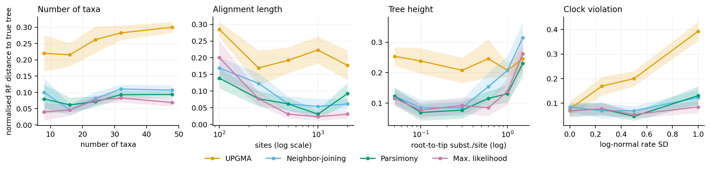

# Phylogenetics from scratch

**What:** UPGMA, neighbor-joining, maximum parsimony and maximum likelihood written from scratch, benchmarked on simulated data where the true tree is known.  
**Result:** Maximum likelihood recovered the exact tree in 67 of 200 datasets, UPGMA in 17; UPGMA breaks as soon as rates differ between lineages.  
**Stack:** Python, NumPy, SciPy, pytest (99 tests)

Four ways to build an evolutionary tree from DNA sequences, written in Python without a
phylogenetics library, plus a benchmark that checks which one gets the tree right and when.
I wanted to understand these algorithms properly instead of just calling them. It started
from the Bioinformatics Algorithms course at the University of Basel (HS 2023).

## Why a benchmark

The methods make different trade-offs. Distance methods (UPGMA, NJ) are fast but reduce the
alignment to one number per pair. Parsimony looks for the tree with the fewest mutations.
Maximum likelihood uses a model of evolution and is the slowest. Which one works best depends
on the data, and with real data the true tree is unknown. So I simulated alignments on known
trees, changed one thing at a time (clock violation, alignment length, divergence, number of
taxa) and measured how far each method's tree is from the truth.

## Results

Setup: Yule trees, JC69 sequences, 16 taxa and 500 sites by default, 10 replicates per
condition, 200 datasets in total.



The clearest effect is the clock violation, measured as the normalised Robinson-Foulds
distance to the true tree (lower is better). With a strict clock all four methods are close,
between 0.069 and 0.085. When the rates vary strongly between lineages (SD 1.0), UPGMA's
error goes up to 0.392, while maximum likelihood stays at 0.085, neighbor-joining at 0.123
and parsimony at 0.131.

Exact tree recovered (RF = 0) over all 200 datasets: UPGMA 17, NJ 54, parsimony 66, ML 67.

- Longer alignments help ML most: from 0.200 at 100 sites to 0.023 at 1000 sites.
- At high divergence the JC69 distances saturate and NJ gets worst (0.315).
- The distance methods take about a millisecond per tree, ML about 7 seconds on average.

With 10 replicates, small differences between NJ, parsimony and ML are within the standard
errors, so I read the curves as trends, not as a ranking.

I also checked the searches against each other: parsimony was never beaten on its own score,
ML once by 0.25 log-likelihood units (a local optimum of the NNI search, not a bug). The
first run showed the parsimony search was too weak on the lineage data, so I added SPR moves
and reran everything.

## CRISPR lineage tracing

A small, experimental module applies the same algorithms to simulated CRISPR lineage-tracing
data, where the "taxa" are cells and the characters are Cas9 edits. All methods are far
better than a random tree, and the number of target sites matters most (parsimony reaches
0.069 with 80 sites). The simulator is a toy model, so this says how the algorithms behave
on the basic problem, not how accurate they would be on real experiments. Details in
[`docs/lineage_tracing.md`](docs/lineage_tracing.md).

## Limitations

- Only the JC69 model, and the simulated data comes from JC69 too, which is the easy case for
  maximum likelihood.
- The tree searches are hill climbing (NNI, plus SPR for parsimony) and can stop at a local
  optimum.
- Pure Python, so much slower than RAxML or IQ-TREE.
- Simulated data only, no real dataset.

## Run

Python 3.9 or newer.

```bash
pip install -e ".[dev]"
python -m pytest                 # 99 tests, under a minute

phylo simulate --taxa 12 --sites 800 --height 0.3 --seed 7 --out-fasta sim.fasta --out-tree true.nwk
phylo infer sim.fasta --method ml --out ml.nwk
phylo compare true.nwk ml.nwk

./reproduce.sh --quick           # small version of the whole benchmark, about a minute
```

## More

- [`docs/details.md`](docs/details.md): everything that is implemented, the full results
  (all panels, runtime, scores on each method's own criterion), the tests, the comparison
  with the R packages ape and phangorn, and how to reproduce every number.
- [`docs/algorithms.md`](docs/algorithms.md): how each algorithm works.

## License

MIT, see [LICENSE](LICENSE).
